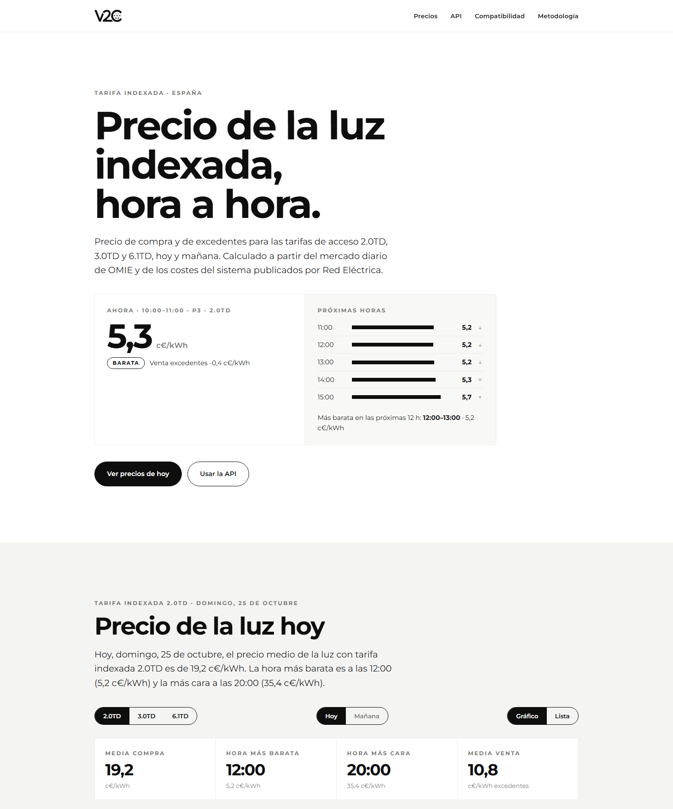

# Tarifas indexadas · Precio de la luz hora a hora en 12 países de Europa

**[electricityprices.v2charge.com](https://electricityprices.v2charge.com)** — precio horario de la luz con
tarifa indexada en **España** (2.0TD, 3.0TD y 6.1TD) y en **Portugal** (simples, bi-horária, tri-horária, BTE
y media tensión), **Países Bajos** (contrato dinámico), **Dinamarca**, **Estonia**, **Letonia**, **Lituania**,
**Austria**, **Francia** (offre dynamique), **Suecia** (SE1–SE4), **Finlandia** (pörssisähkö) e **Italia** (PUN), hoy y mañana. Precio de compra y de venta de excedentes
de autoconsumo. Con **API REST pública y gratuita**, sin registro. Una web por país en su idioma (la portada elige
según el idioma del navegador).

> **Nuevo dominio (23-nov-2026):** `tarifaelectrica.v2charge.com` pasa a ser `electricityprices.v2charge.com`. Las
> integraciones que usan el dominio anterior **siguen funcionando sin cambios**: la API responde igual en los dos y
> la web redirige al nuevo. Recomendamos actualizar la URL cuando te venga bien.

[](https://electricityprices.v2charge.com)

| | |
|---|---|
| España | https://electricityprices.v2charge.com/ · mañana: https://electricityprices.v2charge.com/precio-luz-manana |
| Portugal (português) | https://electricityprices.v2charge.com/pt/ |
| Países Bajos (Nederlands) | https://electricityprices.v2charge.com/nl/ |
| Dinamarca (dansk) | https://electricityprices.v2charge.com/dk/ |
| Austria (Deutsch) | https://electricityprices.v2charge.com/at/ |
| Estonia (eesti) | https://electricityprices.v2charge.com/ee/ |
| Lituania (lietuvių) | https://electricityprices.v2charge.com/lt/ |
| Letonia (latviešu) | https://electricityprices.v2charge.com/lv/ |
| Francia (français) | https://electricityprices.v2charge.com/fr/ |
| Suecia (svenska) | https://electricityprices.v2charge.com/se/ |
| Finlandia (suomi) | https://electricityprices.v2charge.com/fi/ |
| Italia (italiano) | https://electricityprices.v2charge.com/it/ |
| Países disponibles (API) | `https://electricityprices.v2charge.com/v1/countries` |
| API | `https://electricityprices.v2charge.com/v1/…` (también en el dominio anterior) |
| Guía para asistentes de IA | https://electricityprices.v2charge.com/llms.txt |

## Qué ofrece

- **Precio de hoy y de mañana**, hora a hora, para 2.0TD, 3.0TD y 6.1TD (Península) y para Portugal
  continental (BTN simples, bi-horária y tri-horária; BTN > 20,7 kVA; BTE y MT tetra-horárias; ciclo diário y
  semanal), Países Bajos (contrato dinámico, con y sin energiebelasting y btw), Dinamarca (12 distribuidores),
  Estonia, Letonia, Lituania, Austria (14 zonas de red), Francia (TURPE en Base y Heures creuses), Suecia (13
  combinaciones de zona y distribuidora), Finlandia (16 tarifas de 6 distribuidoras) e Italia (PUN horario con
  transporte, oneri y accise).
- **Precio de ahora** destacado en la web, con las próximas horas y la más barata de las siguientes 12 h;
  en el móvil, vista de lista hora a hora.
- **Compra y venta**: precio de la energía consumida y valor de los excedentes vertidos.
- **Periodo tarifario** de cada hora (P1…P6), con fines de semana y festivos nacionales.
- **Horas más baratas** y mejor franja para programar cargas: coche eléctrico, batería, bomba de calor.
- **Simulación de factura** a partir del consumo horario, con excedentes e impuestos.
- **Histórico** desde enero de 2026 y rutas por fecha compatibles con integraciones Node-RED existentes.

## Cuándo consultar

| Qué | Desde (hora peninsular) |
|---|---|
| Precios de hoy | Todo el día |
| Precios de mañana (3.0TD y 6.1TD definitivos, 2.0TD provisional) | 13:15 |
| Precios de mañana definitivos en todas las tarifas | **21:00** |

El mercado diario se publica hacia las 13:00 y ya no cambia. En 2.0TD los costes de ajuste del sistema se
publican hacia las 20:45; hasta entonces se estiman y las horas llevan `"provisional": true`. **Una consulta al
día a partir de las 21:00** deja todas las tarifas cerradas para mañana.

## Uso de la API

- Sin autenticación. Respuestas JSON. Precios en **€/kWh sin impuestos**, horas en hora peninsular.
- **Límite: 30 peticiones por minuto por IP.** Si se supera, `429` con cabecera `Retry-After` (segundos de espera).
- Los precios cambian como mucho una vez al día: guarda la respuesta y reutilízala.
- Opcional: identifica tu integración con la cabecera `X-API-Key: <tu-identificador>` (no es secreta).

### Primeros pasos

```bash
# Precio de la hora actual (2.0TD)
curl "https://electricityprices.v2charge.com/v1/prices/now?tariff=2.0TD"

# Todo el día de mañana (3.0TD)
curl "https://electricityprices.v2charge.com/v1/prices/tomorrow?tariff=3.0TD"

# Las 3 horas más baratas y la mejor franja de 3 horas
curl "https://electricityprices.v2charge.com/v1/prices/cheapest?tariff=2.0TD&n=3&block=3"
```

Respuesta de una hora:

```json
{
  "ts_local": "2026-10-14T20:00:00+02:00",
  "period": "P1",
  "compra_eur_kwh": 0.472063,
  "venta_eur_kwh": 0.289803,
  "provisional": false,
  "pmd_eur_mwh": 293.39,
  "ajustes_eur_mwh": 42.59,
  "perdidas_pct": 15.62,
  "components_eur_kwh": { "energia": 0.37451, "peaje": 0.033261, "cargo": 0.064292 }
}
```

### Endpoints

| Método | Ruta | Descripción |
|---|---|---|
| GET | `/v1/prices?tariff=2.0TD&on=AAAA-MM-DD` | Precios hora a hora de un día, con resumen |
| GET | `/v1/prices/tomorrow?tariff=…` | Precios de mañana (`404` antes de ~13:00) |
| GET | `/v1/prices/now?tariff=…` | Precio de la hora en curso |
| GET | `/v1/prices/cheapest?tariff=…&n=4&block=3` | Horas más baratas y mejor franja contigua |
| POST | `/v1/simulate` | Factura estimada con consumo horario y excedentes |
| GET | `/v1/status` | Qué días tienen precios publicados y si son definitivos |
| GET | `/v1/periods?tariff=…&on=…` | Periodo tarifario de cada hora |
| GET | `/v1/regulated?tariff=…` | Peajes y cargos vigentes |
| GET | `/v1/countries` | Países disponibles, con su web y sus tarifas |

`tariff`: España `2.0TD`, `3.0TD` o `6.1TD` · Portugal (horas de Lisboa; precios con la Tarifa de Acesso às
Redes, sin IVA):

| Portugal | Suministro | Periodos |
|---|---|---|
| `PT-SIMPLES` | BTN ≤ 20,7 kVA | Simples |
| `PT-BI`, `PT-BI-SEMANAL` | BTN ≤ 20,7 kVA | Vazio, Fora de vazio |
| `PT-TRI`, `PT-TRI-SEMANAL` | BTN ≤ 20,7 kVA | Ponta, Cheias, Vazio |
| `PT-TRI-41`, `PT-TRI-41-SEMANAL` | BTN 27,6–41,4 kVA | Ponta, Cheias, Vazio |
| `PT-BTE`, `PT-BTE-SEMANAL` | Baja tensión especial | Ponta, Cheias, Vazio normal, Super vazio |
| `PT-MT` | Media tensión (ciclo semanal, festivos como domingo) | Ponta, Cheias, Vazio normal, Super vazio |

Sin sufijo = ciclo diario; `-SEMANAL` = ciclo semanal.

Países Bajos: contrato dinámico (hora de Ámsterdam, sin periodos) por tramo de consumo anual: `NL` (hasta
10.000 kWh/año), `NL-SCHIJF3` (10–50 MWh), `NL-SCHIJF4` (50 MWh – 10 GWh) y `NL-SCHIJF5` (más de 10 GWh). Cada
hora incluye además `compra_con_impuestos_eur_kwh`, con energiebelasting y btw, el precio que publican las
comercializadoras dinámicas para hogares. No incluye costes fijos (netbeheer, vastrecht).

Dinamarca (`DK-RADIUS`, `DK-CERIUS`, `DK-N1`… por distribuidor), Estonia (`EE-VORK1/2/4/5`), Letonia
(`LV-PAMATA`, `LV-SPECIALAIS`), Lituania (`LT-STANDARTINIS-1/2/4`, `LT-EFEKTYVUS-1/2/4`, `LT-NAMAI-1/2`) y Austria
(`AT-<ZONA>` y `AT-<ZONA>-SNAP` con la tarifa reducida de verano): mercado diario, peajes de red y cargos regulados
por kWh de cada franja, en hora local. Sin cuotas fijas.

Francia (`FR-CU4` cliente «Base», `FR-MU4` cliente «Heures creuses», `FR-LU`): parte de energía del TURPE 7 en 4
franjas (horas punta/valle × invierno noviembre–marzo / verano) y accise; horas valle 22–6 h por defecto (Enedis
las fija para cada contador). Suecia (`SE3-ELLEVIO`, `SE3-VATTENFALL-T4`, `SE4-EON-SYD-VILLA`…): zona SE1–SE4 +
distribuidora, con överföringsavgift y energiskatt; peajes en coronas pasados a € con el cambio del BCE.
Finlandia (`FI-CARUNA-YLEIS`, `FI-ELENIA-YO`, `FI-HELEN-AIKA`…): siirtomaksu de cada distribuidora y sähkövero.
Italia (`IT-DOMESTICO`): PUN Index GME horario + pérdidas, transporte, oneri ASOS/ARIM y accise; `period` es la
fascia F1/F2/F3 y `venta_eur_kwh` el PUN. Fonte PUN: Gestore dei Mercati Energetici S.p.A.

`GET /v1/countries` devuelve los países con su nombre, idioma, zona horaria, web, la lista de sus tarifas y el
nombre del producto en cada país (`product_name`: «Tarifa indexada», «Dynamisch energiecontract», «Pörssisähkö»,
«Offre à tarification dynamique»…; `product_name_es` y la etiqueta corta `product_short`).

Todos los precios principales (`compra_eur_kwh`) van sin impuestos.

### Nombres de las tarifas

`GET /v1/tariffs` devuelve en `catalog` el país y el nombre de cada tarifa para mostrarlo en una app, con el
formato "País · tarifa (para quién)", en el idioma del país (`name`) y en español (`name_es`).

| `tariff` | Nombre en la app (idioma del país) | Nombre en español |
|---|---|---|
| `2.0TD` | España · 2.0TD (hasta 15 kW) | España · 2.0TD (hasta 15 kW) |
| `3.0TD` | España · 3.0TD (más de 15 kW) | España · 3.0TD (más de 15 kW) |
| `6.1TD` | España · 6.1TD (alta tensión) | España · 6.1TD (alta tensión) |
| `PT-SIMPLES` | Portugal · Simples | Portugal · Simple |
| `PT-BI` | Portugal · Bi-horária (ciclo diário) | Portugal · Bihoraria (ciclo diario) |
| `PT-TRI` | Portugal · Tri-horária (ciclo diário) | Portugal · Trihoraria (ciclo diario) |
| `PT-BI-SEMANAL` | Portugal · Bi-horária (ciclo semanal) | Portugal · Bihoraria (ciclo semanal) |
| `PT-TRI-SEMANAL` | Portugal · Tri-horária (ciclo semanal) | Portugal · Trihoraria (ciclo semanal) |
| `PT-TRI-41` | Portugal · Tri-horária > 20,7 kVA (ciclo diário) | Portugal · Trihoraria > 20,7 kVA (ciclo diario) |
| `PT-TRI-41-SEMANAL` | Portugal · Tri-horária > 20,7 kVA (ciclo semanal) | Portugal · Trihoraria > 20,7 kVA (ciclo semanal) |
| `PT-BTE` | Portugal · BTE (ciclo diário) | Portugal · BTE (ciclo diario) |
| `PT-BTE-SEMANAL` | Portugal · BTE (ciclo semanal) | Portugal · BTE (ciclo semanal) |
| `PT-MT` | Portugal · Média tensão | Portugal · Media tensión |
| `NL` | Nederland · Dynamisch (tot 10.000 kWh/jaar) | Países Bajos · Dinámica (hasta 10.000 kWh/año) |
| `NL-SCHIJF3` | Nederland · Dynamisch zakelijk (10–50 MWh/jaar) | Países Bajos · Dinámica empresas (10–50 MWh/año) |
| `NL-SCHIJF4` | Nederland · Dynamisch zakelijk (50 MWh – 10 GWh/jaar) | Países Bajos · Dinámica empresas (50 MWh – 10 GWh/año) |
| `NL-SCHIJF5` | Nederland · Dynamisch grootverbruik (> 10 GWh/jaar) | Países Bajos · Dinámica gran consumo (> 10 GWh/año) |
| `DK-RADIUS` | Danmark · Radius (C-kunde) | Dinamarca · Radius (hogares) |
| `DK-CERIUS` | Danmark · Cerius (C-kunde) | Dinamarca · Cerius (hogares) |
| `DK-N1` | Danmark · N1 (C-kunde) | Dinamarca · N1 (hogares) |
| `DK-N1-344` | Danmark · N1 område 344 (C-kunde) | Dinamarca · N1 zona 344 (hogares) |
| `DK-VORES-ELNET` | Danmark · Vores Elnet (C-kunde) | Dinamarca · Vores Elnet (hogares) |
| `DK-KONSTANT` | Danmark · Konstant (C-kunde) | Dinamarca · Konstant (hogares) |
| `DK-TREFOR` | Danmark · TREFOR El-net (C-kunde) | Dinamarca · TREFOR El-net (hogares) |
| `DK-DINEL` | Danmark · Dinel (C-kunde) | Dinamarca · Dinel (hogares) |
| `DK-NORD-ENERGI` | Danmark · Nord Energi Net (C-kunde) | Dinamarca · Nord Energi Net (hogares) |
| `DK-TREFOR-OST` | Danmark · TREFOR El-net Øst (C-kunde) | Dinamarca · TREFOR El-net Øst (hogares) |
| `DK-NOE` | Danmark · NOE Net (C-kunde) | Dinamarca · NOE Net (hogares) |
| `DK-ELNET-MIDT` | Danmark · Elnet Midt (C-kunde) | Dinamarca · Elnet Midt (hogares) |
| `AT-BURGENLAND` | Österreich · Burgenland (Netzebene 7) | Austria · Burgenland (baja tensión) |
| `AT-BURGENLAND-SNAP` | Österreich · Burgenland (Netzebene 7, Sommer-Niedertarif) | Austria · Burgenland (baja tensión, tarifa reducida de verano) |
| `AT-KAERNTEN` | Österreich · Kärnten (Netzebene 7) | Austria · Carintia (baja tensión) |
| `AT-KAERNTEN-SNAP` | Österreich · Kärnten (Netzebene 7, Sommer-Niedertarif) | Austria · Carintia (baja tensión, tarifa reducida de verano) |
| `AT-KLAGENFURT` | Österreich · Klagenfurt (Netzebene 7) | Austria · Klagenfurt (baja tensión) |
| `AT-KLAGENFURT-SNAP` | Österreich · Klagenfurt (Netzebene 7, Sommer-Niedertarif) | Austria · Klagenfurt (baja tensión, tarifa reducida de verano) |
| `AT-NOE` | Österreich · Niederösterreich (Netzebene 7) | Austria · Baja Austria (baja tensión) |
| `AT-NOE-SNAP` | Österreich · Niederösterreich (Netzebene 7, Sommer-Niedertarif) | Austria · Baja Austria (baja tensión, tarifa reducida de verano) |
| `AT-OOE` | Österreich · Oberösterreich (Netzebene 7) | Austria · Alta Austria (baja tensión) |
| `AT-OOE-SNAP` | Österreich · Oberösterreich (Netzebene 7, Sommer-Niedertarif) | Austria · Alta Austria (baja tensión, tarifa reducida de verano) |
| `AT-LINZ` | Österreich · Linz (Netzebene 7) | Austria · Linz (baja tensión) |
| `AT-LINZ-SNAP` | Österreich · Linz (Netzebene 7, Sommer-Niedertarif) | Austria · Linz (baja tensión, tarifa reducida de verano) |
| `AT-SALZBURG` | Österreich · Salzburg (Netzebene 7) | Austria · Salzburg (baja tensión) |
| `AT-SALZBURG-SNAP` | Österreich · Salzburg (Netzebene 7, Sommer-Niedertarif) | Austria · Salzburg (baja tensión, tarifa reducida de verano) |
| `AT-STEIERMARK` | Österreich · Steiermark (Netzebene 7) | Austria · Estiria (baja tensión) |
| `AT-STEIERMARK-SNAP` | Österreich · Steiermark (Netzebene 7, Sommer-Niedertarif) | Austria · Estiria (baja tensión, tarifa reducida de verano) |
| `AT-GRAZ` | Österreich · Graz (Netzebene 7) | Austria · Graz (baja tensión) |
| `AT-GRAZ-SNAP` | Österreich · Graz (Netzebene 7, Sommer-Niedertarif) | Austria · Graz (baja tensión, tarifa reducida de verano) |
| `AT-TIROL` | Österreich · Tirol (Netzebene 7) | Austria · Tirol (baja tensión) |
| `AT-TIROL-SNAP` | Österreich · Tirol (Netzebene 7, Sommer-Niedertarif) | Austria · Tirol (baja tensión, tarifa reducida de verano) |
| `AT-INNSBRUCK` | Österreich · Innsbruck (Netzebene 7) | Austria · Innsbruck (baja tensión) |
| `AT-INNSBRUCK-SNAP` | Österreich · Innsbruck (Netzebene 7, Sommer-Niedertarif) | Austria · Innsbruck (baja tensión, tarifa reducida de verano) |
| `AT-VORARLBERG` | Österreich · Vorarlberg (Netzebene 7) | Austria · Vorarlberg (baja tensión) |
| `AT-VORARLBERG-SNAP` | Österreich · Vorarlberg (Netzebene 7, Sommer-Niedertarif) | Austria · Vorarlberg (baja tensión, tarifa reducida de verano) |
| `AT-WIEN` | Österreich · Wien (Netzebene 7) | Austria · Viena (baja tensión) |
| `AT-WIEN-SNAP` | Österreich · Wien (Netzebene 7, Sommer-Niedertarif) | Austria · Viena (baja tensión, tarifa reducida de verano) |
| `AT-KLEINWALSERTAL` | Österreich · Kleinwalsertal (Netzebene 7) | Austria · Kleinwalsertal (baja tensión) |
| `AT-KLEINWALSERTAL-SNAP` | Österreich · Kleinwalsertal (Netzebene 7, Sommer-Niedertarif) | Austria · Kleinwalsertal (baja tensión, tarifa reducida de verano) |
| `EE-VORK1` | Eesti · Elektrilevi Võrk 1 (ühtlane) | Estonia · Elektrilevi Võrk 1 (tarifa única) |
| `EE-VORK2` | Eesti · Elektrilevi Võrk 2 (päev/öö) | Estonia · Elektrilevi Võrk 2 (día/noche) |
| `EE-VORK4` | Eesti · Elektrilevi Võrk 4 (päev/öö, suur kuutasu) | Estonia · Elektrilevi Võrk 4 (día/noche, cuota alta) |
| `EE-VORK5` | Eesti · Elektrilevi Võrk 5 (päev/öö + tipp) | Estonia · Elektrilevi Võrk 5 (día/noche + punta) |
| `LT-STANDARTINIS-1` | Lietuva · ESO Standartinis (viena laiko zona) | Lituania · ESO Standartinis (una franja) |
| `LT-STANDARTINIS-2` | Lietuva · ESO Standartinis (dvi laiko zonos) | Lituania · ESO Standartinis (dos franjas) |
| `LT-STANDARTINIS-4` | Lietuva · ESO Standartinis (keturios laiko zonos) | Lituania · ESO Standartinis (cuatro franjas) |
| `LT-EFEKTYVUS-1` | Lietuva · ESO Efektyvus (viena laiko zona) | Lituania · ESO Efektyvus (una franja) |
| `LT-EFEKTYVUS-2` | Lietuva · ESO Efektyvus (dvi laiko zonos) | Lituania · ESO Efektyvus (dos franjas) |
| `LT-EFEKTYVUS-4` | Lietuva · ESO Efektyvus (keturios laiko zonos) | Lituania · ESO Efektyvus (cuatro franjas) |
| `LT-NAMAI-1` | Lietuva · ESO Namai (viena laiko zona) | Lituania · ESO Namai (una franja) |
| `LT-NAMAI-2` | Lietuva · ESO Namai (dvi laiko zonos) | Lituania · ESO Namai (dos franjas) |
| `LV-PAMATA` | Latvija · Sadales tīkls Pamata-1 | Letonia · Sadales tīkls Pamata-1 |
| `LV-SPECIALAIS` | Latvija · Sadales tīkls Speciālais-1 | Letonia · Sadales tīkls Especial-1 |
| `FI-CARUNA-YLEIS` | Suomi · Caruna yleissiirto | Finlandia · Caruna general |
| `FI-CARUNA-YO` | Suomi · Caruna yösiirto | Finlandia · Caruna día/noche |
| `FI-CARUNA-KAUSI` | Suomi · Caruna kausisiirto | Finlandia · Caruna estacional |
| `FI-CARUNAESPOO-YLEIS` | Suomi · Caruna Espoo yleissiirto | Finlandia · Caruna Espoo general |
| `FI-CARUNAESPOO-YO` | Suomi · Caruna Espoo yösiirto | Finlandia · Caruna Espoo día/noche |
| `FI-CARUNAESPOO-KAUSI` | Suomi · Caruna Espoo kausisiirto | Finlandia · Caruna Espoo estacional |
| `FI-ELENIA-YLEIS` | Suomi · Elenia yleissiirto | Finlandia · Elenia general |
| `FI-ELENIA-YO` | Suomi · Elenia yösiirto | Finlandia · Elenia día/noche |
| `FI-ELENIA-KAUSI` | Suomi · Elenia vuodenaikasiirto | Finlandia · Elenia estacional |
| `FI-HELEN-YLEIS` | Suomi · Helen yleissiirto | Finlandia · Helen general (Helsinki) |
| `FI-HELEN-AIKA` | Suomi · Helen aikasiirto | Finlandia · Helen día/noche (Helsinki) |
| `FI-JSE-YLEIS` | Suomi · Järvi-Suomen Energia yleissähkö | Finlandia · Järvi-Suomen Energia general |
| `FI-JSE-YO` | Suomi · Järvi-Suomen Energia yösähkö | Finlandia · Järvi-Suomen Energia día/noche |
| `FI-JSE-KAUSI` | Suomi · Järvi-Suomen Energia vuodenaikasähkö | Finlandia · Järvi-Suomen Energia estacional |
| `FI-OULU-YLEIS` | Suomi · Oulun Energia yleissiirto | Finlandia · Oulun Energia general |
| `FI-OULU-AIKA` | Suomi · Oulun Energia aikasiirto | Finlandia · Oulun Energia día/noche |
| `IT-DOMESTICO` | Italia · Domestico (PUN orario) | Italia · Doméstico (PUN horario) |
| `FR-CU4` | France · Base (TURPE CU4) | Francia · Base (TURPE CU4) |
| `FR-MU4` | France · Heures creuses (TURPE MU4) | Francia · Horas valle (TURPE MU4) |
| `FR-LU` | France · Longue utilisation (TURPE LU) | Francia · Larga utilización (TURPE LU) |
| `SE3-ELLEVIO` | Sverige · Ellevio (SE3) | Suecia · Ellevio (SE3) |
| `SE3-VATTENFALL-E4` | Sverige · Vattenfall Enkeltariff (SE3) | Suecia · Vattenfall tarifa simple (SE3) |
| `SE3-VATTENFALL-T4` | Sverige · Vattenfall Tidstariff (SE3) | Suecia · Vattenfall tarifa horaria (SE3) |
| `SE1-VATTENFALL-E4` | Sverige · Vattenfall Enkeltariff (SE1) | Suecia · Vattenfall tarifa simple (SE1) |
| `SE1-VATTENFALL-T4` | Sverige · Vattenfall Tidstariff (SE1) | Suecia · Vattenfall tarifa horaria (SE1) |
| `SE4-EON-SYD-VILLA` | Sverige · E.ON Syd Villa 20-25 A (SE4) | Suecia · E.ON Sur vivienda 20-25 A (SE4) |
| `SE4-EON-SYD-VILLA16` | Sverige · E.ON Syd Villa 16 A (SE4) | Suecia · E.ON Sur vivienda 16 A (SE4) |
| `SE4-EON-SYD-LGH` | Sverige · E.ON Syd Lägenhet (SE4) | Suecia · E.ON Sur apartamento (SE4) |
| `SE3-EON-SYD-VILLA` | Sverige · E.ON Syd Villa 20-25 A (SE3) | Suecia · E.ON Sur vivienda 20-25 A (SE3) |
| `SE3-EON-STHLM-VILLA` | Sverige · E.ON Stockholm Villa 20-25 A (SE3) | Suecia · E.ON Estocolmo vivienda 20-25 A (SE3) |
| `SE3-EON-STHLM-VILLA16` | Sverige · E.ON Stockholm Villa 16 A (SE3) | Suecia · E.ON Estocolmo vivienda 16 A (SE3) |
| `SE3-EON-STHLM-LGH` | Sverige · E.ON Stockholm Lägenhet (SE3) | Suecia · E.ON Estocolmo apartamento (SE3) |
| `SE2-EON-NORD-VILLA` | Sverige · E.ON Nord Villa 20-25 A (SE2) | Suecia · E.ON Norte vivienda 20-25 A (SE2) |

`product` (opcional): `indexada` (por defecto) o `indexada_con_ajustes` (incluye también los costes de ajuste
del sistema en 3.0TD y 6.1TD).

### Rutas por fecha (compatibles con flujos Node-RED existentes)

`TU_ID` es un identificador libre de tu instalación.

| Ruta | Contenido |
|---|---|
| `/TU_ID/indexada/AAAA-MM-DD/` | Horario 2.0TD (`/3/` para 3.0TD, `/6/` para 6.1TD) |
| `/TU_ID/indexada/AAAA-MM/` | Medias diarias del mes |
| `/TU_ID/indexada/AAAA/` | Medias mensuales del año |
| `/TU_ID/omie/AAAA-MM-DD/` | Mercado diario, €/kWh |
| `/TU_ID/pvpc/AAAA-MM-DD/` | PVPC 2.0TD, €/kWh |

Campos: `costeConsumo`, `costePeaje`, `pagoVertido`, `perdidas`, `periodo`, `fecha`, `hora`.

## Ejemplos

| Entorno | Archivo |
|---|---|
| curl | [examples/curl.sh](examples/curl.sh) |
| Python | [examples/python/precios.py](examples/python/precios.py) |
| JavaScript (Node 18+ / navegador) | [examples/javascript/precios.mjs](examples/javascript/precios.mjs) |
| Home Assistant | [examples/home-assistant/sensor.yaml](examples/home-assistant/sensor.yaml) |
| Node-RED | [examples/node-red/flow.json](examples/node-red/flow.json) |

## Novedades

- **24-nov-2026** · **Francia, Suecia y Finlandia**: precios por hora con peajes e impuestos de cada país, en la
  API y en la web (`/fr/`, `/se/`, `/fi/`, cada una en su idioma; Suecia en öre/kWh). Nuevo `GET /v1/countries`
  para saber qué países hay y sus tarifas.
- **24-nov-2026** · **Italia**: precio por hora indexado al PUN con transporte, oneri y accise, en la
  API (`IT-DOMESTICO`) y en la web en italiano (`/it/`). 104 tarifas en 12 países.

- **23-nov-2026** · **Nuevo dominio** `electricityprices.v2charge.com` (el anterior sigue funcionando para la API).
  **Web para todos los países**, cada una en su idioma: Dinamarca (`/dk/`, con selector de distribuidora y precios
  en øre/kWh), Austria (`/at/`, zona de red y Sommer-Niedertarif), Estonia (`/ee/`), Lituania (`/lt/`) y Letonia
  (`/lv/`), además de España, Portugal y Países Bajos. Selector de país en la cabecera.

- **26-oct-2026** · **Dinamarca, Estonia, Letonia, Lituania y Austria**: precio por hora con peajes y cargos de cada
  país (71 tarifas en total). En Dinamarca los peajes de cada distribuidor se actualizan solos cada día.
- **26-oct-2026** · **Países Bajos para empresas**: tarifas por tramo de consumo anual (`NL-SCHIJF3`,
  `NL-SCHIJF4`, `NL-SCHIJF5`). Nuevo `catalog` en `/v1/tariffs` con el nombre de cada tarifa para apps.
- **26-oct-2026** · **Países Bajos**: precio por hora del contrato dinámico (`tariff=NL`), sin impuestos y con
  energiebelasting y btw, para hoy y mañana. Web en neerlandés en `/nl/`.
- **25-oct-2026** · **Portugal, más potencia**: BTN de 27,6 a 41,4 kVA (`PT-TRI-41`), BTE (`PT-BTE`) y media
  tensión (`PT-MT`), con sus periodos tetra-horários y festivos nacionales. BTE y MT están en la web portuguesa
  y se marcan como estimación hasta contrastarlos con precios de una comercializadora.
- **25-oct-2026** · **Portugal**: precios de hoy y mañana para BTN (simples, bi-horária y tri-horária, ciclo
  diario y semanal) en la API y en la web, que ahora está también en portugués y elige idioma según el navegador.

- **25-oct-2026** · Precio todavía más ajustado en las tres tarifas, también para los periodos de invierno.
  Nuevo campo `perdidas_pct` en cada hora y nuevo producto `indexada_con_ajustes`.
- **25-oct-2026** · Límite ampliado a 30 peticiones por minuto por IP.
- **25-oct-2026** · Web: precio de ahora destacado, próximas horas y vista de lista en el móvil.
- **13-oct-2026** · Lanzamiento: precios de hoy y mañana para 2.0TD, 3.0TD y 6.1TD, API pública y rutas por fecha.

## Fuentes

Datos oficiales de OMIE, Red Eléctrica (ESIOS), CNMC y el Ministerio para la Transición Ecológica; para
Portugal, OMIE, ERSE y E-REDES; para Países Bajos, ENTSO-E Transparency Platform (con EnergyZero como respaldo)
y Belastingdienst; Dinamarca, Energinet (DataHub); Estonia, Elektrilevi y Elering; Letonia, Sadales tīkls y AST;
Lituania, ESO y VERT; Austria, E-Control; Francia, CRE (TURPE 7) y ENTSO-E; Suecia, Skatteverket y las
distribuidoras (Ellevio, Vattenfall Eldistribution, E.ON Energidistribution); Finlandia, Verohallinto y las
distribuidoras (Caruna, Elenia, Helen Sähköverkko, Järvi-Suomen Energia, Oulun Energia); Italia, Gestore dei
Mercati Energetici S.p.A. (PUN Index GME), ARERA y Agenzia delle Dogane e dei Monopoli.

## Aviso

Precios orientativos, sin IVA ni impuesto eléctrico. Cada comercializadora aplica sus propios coeficientes:
el precio de tu factura puede variar. Por seguridad y control de uso, la API registra la IP y las peticiones
durante 31 días.

---

Un servicio de **[V2C](https://v2charge.com/es/)** · Contacto: info@v2charge.com
