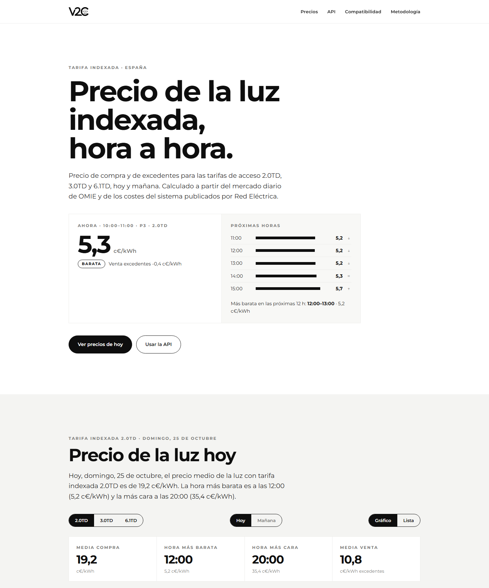

# Tarifas indexadas · Precio de la luz hora a hora en España

**[tarifaelectrica.v2charge.com](https://tarifaelectrica.v2charge.com)** — precio horario de la luz con
tarifa indexada para las tarifas de acceso **2.0TD, 3.0TD y 6.1TD**, hoy y mañana. Precio de compra y de
venta de excedentes de autoconsumo. Con **API REST pública y gratuita**, sin registro.

[](https://tarifaelectrica.v2charge.com)

| | |
|---|---|
| Web | https://tarifaelectrica.v2charge.com |
| Precio de mañana | https://tarifaelectrica.v2charge.com/precio-luz-manana |
| API | `https://tarifaelectrica.v2charge.com/v1/…` |
| Guía para asistentes de IA | https://tarifaelectrica.v2charge.com/llms.txt |

## Qué ofrece

- **Precio de hoy y de mañana**, hora a hora, para 2.0TD, 3.0TD y 6.1TD (Península).
- **Precio de ahora** destacado en la web, con las próximas horas y la más barata de las siguientes 12 h;
  en el móvil, vista de lista hora a hora.
- **Compra y venta**: precio de la energía consumida y valor de los excedentes vertidos.
- **Periodo tarifario** de cada hora (P1…P6), con fines de semana y festivos nacionales.
- **Horas más baratas** y mejor franja para programar cargas: coche eléctrico, batería, bomba de calor.
- **Simulación de factura** a partir del consumo horario, con excedentes e impuestos.
- **Histórico** desde enero de 2026 y rutas por fecha compatibles con integraciones Node-RED existentes.

## Cuándo consultar

| Qué | Desde (hora peninsular) |
|---|---|
| Precios de hoy | Todo el día |
| Precios de mañana (3.0TD y 6.1TD definitivos, 2.0TD provisional) | 13:15 |
| Precios de mañana definitivos en todas las tarifas | **21:00** |

El mercado diario se publica hacia las 13:00 y ya no cambia. En 2.0TD los costes de ajuste del sistema se
publican hacia las 20:45; hasta entonces se estiman y las horas llevan `"provisional": true`. **Una consulta al
día a partir de las 21:00** deja todas las tarifas cerradas para mañana.

## Uso de la API

- Sin autenticación. Respuestas JSON. Precios en **€/kWh sin impuestos**, horas en hora peninsular.
- **Límite: 30 peticiones por minuto por IP.** Si se supera, `429` con cabecera `Retry-After` (segundos de espera).
- Los precios cambian como mucho una vez al día: guarda la respuesta y reutilízala.
- Opcional: identifica tu integración con la cabecera `X-API-Key: <tu-identificador>` (no es secreta).

### Primeros pasos

```bash
# Precio de la hora actual (2.0TD)
curl "https://tarifaelectrica.v2charge.com/v1/prices/now?tariff=2.0TD"

# Todo el día de mañana (3.0TD)
curl "https://tarifaelectrica.v2charge.com/v1/prices/tomorrow?tariff=3.0TD"

# Las 3 horas más baratas y la mejor franja de 3 horas
curl "https://tarifaelectrica.v2charge.com/v1/prices/cheapest?tariff=2.0TD&n=3&block=3"
```

Respuesta de una hora:

```json
{
  "ts_local": "2026-10-14T20:00:00+02:00",
  "period": "P1",
  "compra_eur_kwh": 0.472063,
  "venta_eur_kwh": 0.289803,
  "provisional": false,
  "pmd_eur_mwh": 293.39,
  "ajustes_eur_mwh": 42.59,
  "perdidas_pct": 15.62,
  "components_eur_kwh": { "energia": 0.37451, "peaje": 0.033261, "cargo": 0.064292 }
}
```

### Endpoints

| Método | Ruta | Descripción |
|---|---|---|
| GET | `/v1/prices?tariff=2.0TD&on=AAAA-MM-DD` | Precios hora a hora de un día, con resumen |
| GET | `/v1/prices/tomorrow?tariff=…` | Precios de mañana (`404` antes de ~13:00) |
| GET | `/v1/prices/now?tariff=…` | Precio de la hora en curso |
| GET | `/v1/prices/cheapest?tariff=…&n=4&block=3` | Horas más baratas y mejor franja contigua |
| POST | `/v1/simulate` | Factura estimada con consumo horario y excedentes |
| GET | `/v1/status` | Qué días tienen precios, ajustes y coeficiente de pérdidas publicados |
| GET | `/v1/periods?tariff=…&on=…` | Periodo tarifario de cada hora |
| GET | `/v1/regulated?tariff=…` | Peajes y cargos vigentes |

`tariff`: `2.0TD`, `3.0TD` o `6.1TD`.

`product` (opcional): `indexada` (por defecto: servicios de ajuste repercutidos en 2.0TD) o
`indexada_con_ajustes` (coste completo: también en 3.0TD y 6.1TD).

### Rutas por fecha (compatibles con flujos Node-RED existentes)

`TU_ID` es un identificador libre de tu instalación.

| Ruta | Contenido |
|---|---|
| `/TU_ID/indexada/AAAA-MM-DD/` | Horario 2.0TD (`/3/` para 3.0TD, `/6/` para 6.1TD) |
| `/TU_ID/indexada/AAAA-MM/` | Medias diarias del mes |
| `/TU_ID/indexada/AAAA/` | Medias mensuales del año |
| `/TU_ID/omie/AAAA-MM-DD/` | Mercado diario, €/kWh |
| `/TU_ID/pvpc/AAAA-MM-DD/` | PVPC 2.0TD, €/kWh |

Campos: `costeConsumo`, `costePeaje`, `pagoVertido`, `perdidas`, `periodo`, `fecha`, `hora`.

## Ejemplos

| Entorno | Archivo |
|---|---|
| curl | [examples/curl.sh](examples/curl.sh) |
| Python | [examples/python/precios.py](examples/python/precios.py) |
| JavaScript (Node 18+ / navegador) | [examples/javascript/precios.mjs](examples/javascript/precios.mjs) |
| Home Assistant | [examples/home-assistant/sensor.yaml](examples/home-assistant/sensor.yaml) |
| Node-RED | [examples/node-red/flow.json](examples/node-red/flow.json) |

## Cómo se calcula

```
pérdidas = coeficiente oficial del periodo × K horario
compra   = mercado × (1 + pérdidas) + w × ajustes + peaje + cargo
venta    = mercado − descuento
```

- **mercado**: precio del mercado diario de OMIE (España), media horaria de los cuartos de hora.
- **pérdidas**: coeficiente de pérdidas de cada tarifa y periodo fijado por la CNMC (Circular 3/2020,
  art. 11) multiplicado por el coeficiente K horario de ajuste de pérdidas que publica Red Eléctrica. Cada hora
  lo devuelve en `perdidas_pct`.
- **ajustes**: servicios de ajuste y otros costes del sistema publicados por Red Eléctrica (ESIOS).
  `w` es el peso con que los repercute el producto.
- **descuento**: diferencia aplicada al precio de los excedentes en 2.0TD.
- **peaje y cargo**: valores regulados (CNMC y Ministerio para la Transición Ecológica) por periodo.

Fuentes: OMIE, Red Eléctrica (ESIOS), CNMC, MITECO.

## Aviso

Precios orientativos, sin IVA ni impuesto eléctrico. Cada comercializadora aplica sus propios coeficientes:
el precio de tu factura puede variar. Por seguridad y control de uso, la API registra la IP y las peticiones
durante 31 días.

---

Un servicio de **[V2C](https://v2charge.com/es/)** · Contacto: info@v2charge.com
